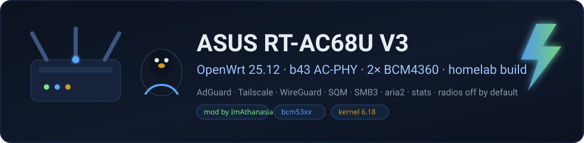
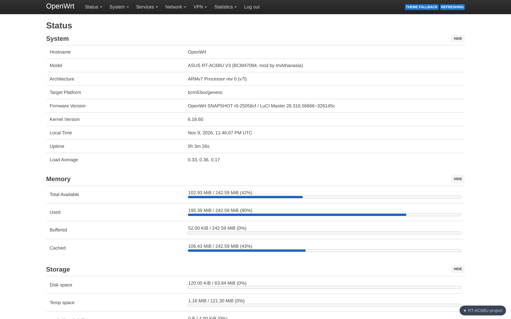
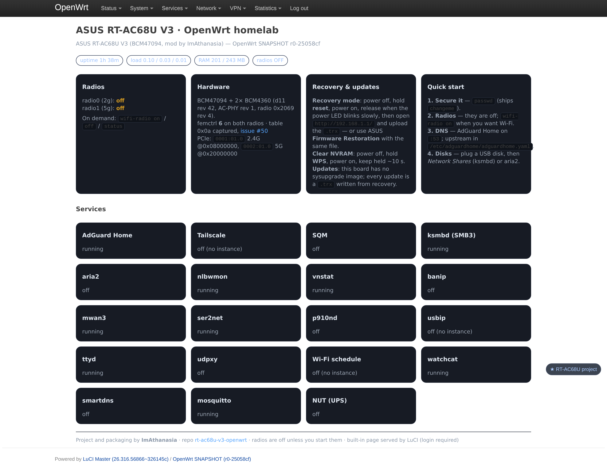

<p align="center"></p>

# ASUS RT-AC68U V3 — a 2012 router running a 2026 homelab stack

**Project and packaging: [@ImAthanasia](https://github.com/ImAthanasia).**

<p>
 
 
 
</p>

This is a 1 GHz Cortex-A9 with 256 MB of RAM and 128 MB of NAND — the kind of box that shipped with
Linux 2.6 and a web UI with three tabs. On this image it is a DNS-level ad blocker for the whole
house, a zero-port remote-access node, a VPN server, a traffic shaper, a SMB3 file server, a
download station, and a per-device traffic accountant — with an open-source **b43 AC-PHY** driver
for both BCM4360 radios and a project page inside LuCI that shows what the box is doing.

Nothing here is emulated or "demo": every number on the page is read from this unit through ubus,
and every package was built for it.

## What this image gives you

- **Ad blocking for every device** — AdGuard Home on port 53, DoH upstream, per-client stats.
- **Remote access without ports** — Tailscale (off until it has a node key), WireGuard, OpenVPN, ocserv.
- **Calls stay smooth** — SQM/cake shaping on the uplink.
- **Storage** — ksmbd SMB3 shares, aria2 downloads onto a hot-plugged disk, smartmontools.
- **Visibility** — nlbwmon per device, vnstat totals, collectd graphs, speedtest-go.
- **Peripherals** — ser2net, p910nd print server, usbip, WoL/UPnP.
- **Guard rails** — banip, watchcat, mwan3 failover, Wi-Fi schedule.
- **Wi-Fi on demand** — `wifi-radio on|off|status`; at boot nothing is transmitted.
- **A real project page** — *Services → ★ RT-AC68U*: radio state, hardware (femctrl 6, PHY table
  0x0a capture), service states, recovery steps, quick start, and a Wi-Fi QR when a radio is on.
- **Branding you can see** — version string, DTS model and a footer badge on every LuCI page.

## Why this is more than "another router image"

- **AC-PHY b43**: the open driver for BCM4360 (d11 rev 42) with both radios working on a
  BCM47094 — no proprietary `wl` blob, no half-broken 2.4 GHz.
- **It runs the modern stack on 256 MB**: AdGuard Home + Tailscale + WireGuard + SQM + ksmbd +
  aria2 + collectd at ~200 MB RAM used.
- **It does not transmit unless asked**: radios off by default, and the page says so.
- **It documents itself**: the built-in page, `docs/discoveries.md`, and the PHY read-back data
  published upstream in [aleferri/b43-ac-wip#50](https://github.com/aleferri/b43-ac-wip/issues/50).

<p align="center">


</p>

More in [`images/`](images/) — login, statistics, nlbwmon, SQM, wireless, AdGuard.

## Hardware

| | |
|---|---|
| SoC | Broadcom **BCM47094** (BCM53011 switch), ARMv7 Cortex-A9, 2 cores @ 1 GHz |
| RAM | 256 MB |
| Flash | 128 MB NAND (Macronix, 2 KB page, BCH ECC) |
| Wi-Fi | 2× **BCM4360** (d11 core rev 42, AC-PHY rev 1, radio 0x2069 rev 4, femctrl **6**) |
| Ethernet | 4× GbE LAN + 1× GbE WAN (BCM53011) |
| USB | 1× USB 3.0 + 1× USB 2.0 |

## Build

```sh
./scripts/build.sh                      # config/config.homelab-v3
CFG=config/config.acphy ./scripts/build.sh   # the plain AC-PHY image
```

Source: OpenWrt 25.12 + flatstik/AC66U_B1 branch `b43-ac-phy` @ `25058cf7`, kernel 6.18.60,
b43 AC-PHY. Artifact: `bin/targets/bcm53xx/generic/openwrt-bcm53xx-generic-asus_rt-ac68u-v3-squashfs.trx`.
Build notes and traps in [`docs/build.md`](docs/build.md) and [`docs/discoveries.md`](docs/discoveries.md).

## Flash and recover

There is **no sysupgrade image** for this board; every install or update is a `.trx` written from
recovery:

1. Power off, hold **reset**, power on, release when the power LED blinks slowly.
2. Open `http://192.168.1.1/` and upload the `.trx` — or use ASUS **Firmware Restoration** with
   the same file.
3. **Clear NVRAM** when coming from another firmware: power off, hold **WPS**, power on, keep
   held ~10 s.

## First run

| | |
|---|---|
| Address | `192.168.1.200` (AP mode, upstream `192.168.1.1`, DHCP off) |
| Login | `root` / `changeme` — change it with `passwd` |
| Radios | off; `wifi-radio on` when you want Wi-Fi |
| Page | *Services → ★ Router project* (`/cgi-bin/luci/admin/services/router`; the old `rtac68u` path redirects) |

## Documentation

[use-cases](docs/use-cases.md) · [limitations](docs/limitations.md) ·
[optional packages](docs/optional-packages.md) · [discoveries](docs/discoveries.md) ·
[features preview](docs/features-preview.html) · [AC3200 backport list](docs/ac3200-backport.md) ·
[R7000 probe plan](docs/r7000-probe-plan.md) · [femctrl 6 read-back](docs/femctrl6-readback.md)

## Versioning

GitHub releases start at **v1.0**; the internal build trail (v1 AC-PHY image, v2 homelab packages,
v3 page/branding) is kept in [`CHANGELOG.md`](CHANGELOG.md). Firmware images live in **Releases**;
the tree carries checksums only.

## License and credits

Project files, page and docs: MIT (see `LICENSE`). Firmware: OpenWrt (GPL-2.0) with
flatstik's AC-PHY b43 work, built on aleferri/b43-ac-wip. See [`NOTICE`](NOTICE).
